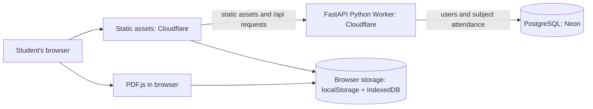

# BunkBudget — Project Blueprint

**Project release described:** 2.1.1

**Last updated:** 2026-11-13

This document shows how the BunkBudget pieces fit together. It is an architecture guide, not a list of secrets. Connection strings and signing keys belong in local `.env` or the hosting provider's secret settings.

## 1. Big picture



The static frontend contains HTML, CSS, and Vanilla JavaScript. Cloudflare Workers publishes the generated `dist/` files alongside the FastAPI API. PostgreSQL on Neon stores accounts and subject attendance. Local timetable entries and report files stay in the browser.

## 2. Frontend pieces

| File | What it is responsible for |
|---|---|
| `index.html` | Sends visitors to the account page. |
| `auth.html` / `auth.js` | Signup and login form, frontend validation, calls to `/api/register` and `/api/login`, saves the JWT, and redirects to the dashboard. |
| `dashboard.html` | Main tracker layout, manual subject/timetable controls, PDF import UI, day-bunk controls, and report archive. |
| `app.js` | Attendance math, rendering, local saving, day-bunk simulations, weekly plan, IndexedDB report history, and API attendance sync. |
| `pdf-import.js` | Loads PDF.js, extracts PDF text and timetable positions in the browser, and sends parsed rows to the review UI. |
| `style.css` | Shared responsive dark theme and component styling. |
| `api-config.js` | Uses `http://localhost:8000` on localhost; production uses a same-origin `/api` path. |
| `scripts/build-cloudflare.mjs` | Copies safe static files and PDF.js assets into `dist/` for Cloudflare Static Assets. |
| `scripts/build-netlify.mjs` | Copies the same files into `dist/` and writes an optional Netlify API proxy rule. |

### Browser storage

- `localStorage` holds the overall tracker state, subjects, weekday timetable, JWT, and a marker for first cloud sync.
- IndexedDB holds uploaded attendance reports and their versions as files.
- Browser storage is local to the current browser profile/device unless a specific API sync feature is used.
- The PDF importer parses on the device; it does not upload PDF contents to FastAPI.

## 3. Backend and database

### FastAPI service

`main.py` creates the FastAPI application and routes. It uses `asyncpg` for PostgreSQL connections so the same API can run through Cloudflare Hyperdrive. Password bcrypt hashes are created and verified by Neon `pgcrypto` so CPU-heavy hashing does not run inside the Worker. The API uses Pydantic v2 schemas from `schemas.py`; `models.py` remains for the local admin CLI.

| Route | Purpose | Authentication |
|---|---|---|
| `GET /api/health` | Basic deployment health response. | No token required. |
| `POST /api/register` | Validate a student profile, hash its password with Neon `pgcrypto`, store the user, and return a JWT. | Public. |
| `POST /api/login` | Match USN, registration number, or email and verify the bcrypt password in Neon. | Public. |
| `POST /api/sync` | Create/update the signed-in user's subject attendance; can replace deleted records when requested. | Bearer JWT. |
| `GET /api/attendance` | Return the signed-in user's subject attendance. | Bearer JWT. |
| `GET /api/admin/stats` | Return aggregate account/subject counts. | Admin role and `ADMIN_EMAIL` match required. |

### Database tables

- **`users`**: UUID, name, class, email, USN, registration number, phone, role, and bcrypt password hash. Unique identifiers prevent duplicate accounts.
- **`subject_attendance`**: UUID, owning user UUID, browser subject ID, subject name, attended count, total count, and target percentage. User ownership plus browser subject ID is unique.

The API does not change the database schema at startup. Apply the idempotent SQL in `scripts/cloudflare-neon-migration.sql` once to create the required tables, indexes, and `pgcrypto` extension while preserving existing rows.

## 4. Authentication and request flow

1. `auth.js` sends JSON to the same-origin `/api` path in production or `http://localhost:8000/api` during local development.
2. FastAPI validates the data with Pydantic. Neon `pgcrypto` creates or verifies bcrypt hashes at cost 12; existing `$2b$` hashes are normalized for PostgreSQL's bcrypt verifier.
3. Successful signup/login returns a JWT signed with `SECRET_KEY`. The browser stores that token in localStorage.
4. On dashboard load, `dashboard.html` exposes the stored token to `app.js`. Attendance sync sends it in the `Authorization: Bearer ...` header.
5. FastAPI verifies the signature and expiry, gets the account UUID from the token, and scopes subject queries to that UUID.

The registration request does not accept a role. Every new account is a student. Admin use requires a database role of `admin` and a matching configured `ADMIN_EMAIL`.

## 5. Attendance calculation and planning

- Overall effective total: `total classes − NA slots`.
- Overall percentage: `present ÷ effective total × 100`.
- For target `t`, present `P`, and effective total `E`, classes that can be skipped while staying at target: `floor((P − t × E) ÷ t)` when already at/above target.
- Classes to attend in a row to recover from below target: `ceil((t × E − P) ÷ (1 − t))`.
- The day simulation subtracts one currently counted attended class per occurrence of a subject on that weekday, then checks it against the target.
- The weekly plan evaluates the possible combinations of scheduled weekdays. It uses known attendance counts and the saved weekly subject frequency. Incomplete records prevent a safe whole-day recommendation.

The recommendation is an estimate based on the timetable. It cannot account for future attendance records, cancellations, holidays, or timetable changes unless the student updates the app.

## 6. PDF import flow

1. A PDF is selected or dropped into the attendance or timetable area.
2. `pdf-import.js` loads PDF.js and extracts selectable text with page positions. It rejects files over 35 MB and documents over 100 pages.
3. Attendance parsing looks for subject labels, attendance count pairs, and percentage rows. Timetable parsing looks for weekday headers/columns or weekday-labeled lines.
4. Parsed entries are shown in an editable preview. The student applies them only after review.
5. The same PDF is added to IndexedDB report history, keeping older versions with the same filename.

The parser does not run OCR. Image-only PDFs and unfamiliar layouts may return no rows or imperfect results; review and manual editing remain necessary.

## 7. Build and deployment

### Local development

- Python version target: 3.13 (`.python-version`); Cloudflare Python Workers require Python 3.13 or newer.
- Start backend from the project root: `uvicorn main:app --reload --port 8000`.
- Serve the frontend from the project root in a second terminal: `python -m http.server 5500`.
- Open `http://localhost:5500`. Do not open the HTML with a `file://` URL.
- Keep `.env` local. Local Uvicorn needs `DATABASE_URL`, `SECRET_KEY`, and `ADMIN_EMAIL`; the Worker uses Hyperdrive plus Worker secrets.

### Production shape

- **Cloudflare Workers** builds static assets with `npm run build:worker` and runs the FastAPI app via the Python ASGI entrypoint in `worker.py`; deploy with `uv run pywrangler deploy`.
- **Netlify** can still serve the frontend separately; the build writes `/api/*` as a proxy to the Cloudflare Worker.
- **Neon** provides PostgreSQL. The Worker connects using a Hyperdrive binding; keep its source connection string in Cloudflare, never in source files.
- When Netlify serves the frontend, its build writes `/api/*` as a rewrite to the Cloudflare Worker. `BUNKBUDGET_API_URL` can override the default Worker origin at build time.
- Run `scripts/cloudflare-neon-migration.sql` once before the first Worker deployment. The API no longer creates or alters database tables during app startup.

### Deployment and current status

Cloudflare routes the Worker at `https://attend.vishwasbnglr2024.workers.dev`. A `404` from `/api/health` means the generic Wrangler deployment is not serving the FastAPI application. Configure Workers Builds to run `uv sync && npm ci && npm run build:worker` and `uv run pywrangler deploy`, set up Hyperdrive and Worker secrets, and then verify `/api/health` returns `{"status":"ok"}`. See `CLOUDFLARE_DEPLOYMENT.md` for the full setup.

## 8. Repository map

```text
auth.html, auth.js       Sign in and account creation
dashboard.html           Tracker, PDF import, schedule, report archive
app.js                   Tracker state, calculations, rendering, cloud sync
pdf-import.js            PDF text extraction and parsing
style.css                Page styles and responsive layout
main.py                  FastAPI routes, JWT auth, and asyncpg database access
worker.py                Cloudflare Python Worker ASGI entrypoint
models.py                SQLAlchemy models used by the local admin CLI
schemas.py               Pydantic input/output validation
requirements.txt         Python runtime dependencies
pyproject.toml           Cloudflare Worker dependencies
wrangler.jsonc           Cloudflare Worker and Hyperdrive configuration
package.json             Node build and PDF.js dependencies
scripts/build-netlify.mjs Static Netlify bundle builder and API rewrite
scripts/build-cloudflare.mjs Static Worker asset bundle builder
scripts/promote_admin.py Promote an existing user to admin using local .env
scripts/cloudflare-neon-migration.sql One-time Neon schema/extension migration
netlify.toml             Netlify build settings
CLOUDFLARE_DEPLOYMENT.md Cloudflare, Neon, and Netlify deployment guide
.env.example             Names and examples for local environment settings
README.md                 Setup, feature list, and version history
PRD.md                    Product requirements and user behavior
PROJECT_BLUEPRINT.md      Architecture and data flows
TECH_STACK.md             Languages, packages, services, and versions
```
